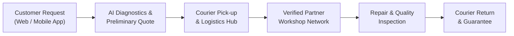
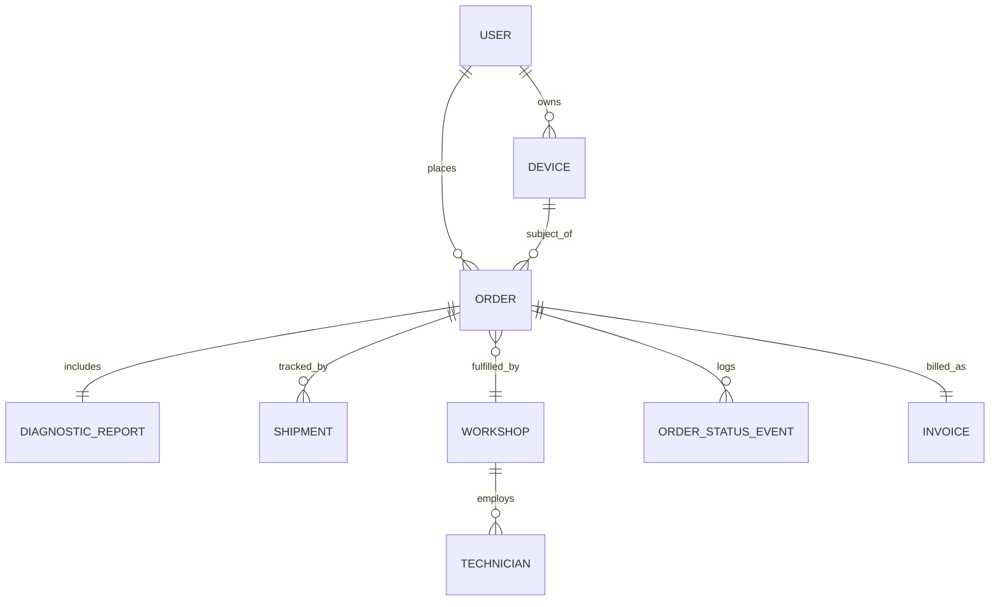

# Repair God (`repair_god_indev`) — Agent Context & Specification

> **Primary Source of Truth** for AI coding assistants and developers collaborating on the **Repair God** platform.  
> **Order of Precedence (Источники правды по порядку приоритета):**  
> 1. `AGENTS.md`  
> 2. `docs/architecture/backend-stack.md`  
> 3. `docs/architecture/frontend-stack.md`  
> 4. `docs/fsm.md`  
> 5. `.agents/rules/`  
> 
> Grounded in the product definition from **The Idea Napkin (ORBIT Ventures)**.

---

## 1. Project Overview & Vision

**Repair God** is a digital platform and aggregator for electronic device repair and lifecycle management. It acts as a trusted intermediary connecting device owners with verified repair workshops while fully managing end-to-end logistics (courier pick-up and delivery), standardized service terms, and AI-assisted diagnostics.

### Elevator Pitch
An aggregator and service intermediary that organizes the complete repair and maintenance lifecycle of electronic devices (including door-to-door transport). It relieves customers of manual search, price comparison, opaque quotes, and delivery logistics.

---

## 2. Target Audience & Stakeholders

| Stakeholder Group | Description & Needs |
| :--- | :--- |
| **B2C (End Consumers)** | Individuals with broken smartphones, laptops, consoles, tablets, or home electronics who value convenience, fixed upfront pricing, and trusted warranties. |
| **B2B (Corporate Clients)** | Companies with device fleets (employee laptops, office gear) requiring lifecycle management, bulk repairs, and predictable SLA-backed service plans. |
| **Partner Workshops (Repair Centers)** | Independent repair shops and certified technicians gaining a steady flow of pre-diagnosed orders, standard terms, and an additional revenue channel without marketing overhead. |
| **Logistics & Retail Partners** | Courier services handling pick-up/drop-off, and retail electronics stores serving as physical intake/drop points or warranty partners. |

### 2.1. Detailed User Persona: "Pragmatyczny menedżer domowego budżetu i elektroniki" (B2C Primary Persona)

| Pole | Wartość | Argumentacja i źródła statystyczne |
| :--- | :--- | :--- |
| **Nazwa persony** | **Michał lub Magdalena Kowalska** | Neutralna reprezentacja statystyczna gospodarstwa domowego w dużej aglomeracji miejskiej. |
| **Stanowisko persony** | Pracownik wiedzy / Specjalista / Project Manager / Koordynator | Reprezentuje szeroki segment pracowniczy (white-collar) w aglomeracjach, znacznie liczniejszy niż wąska grupa programistów (~3,5% siły roboczej). |
| **Opis stanowiska** | Uporządkowana praca, sztywne deadline’y, potrzeba niezawodnego sprzętu, gdyż jego brak oznacza stratę finansową i dezorganizację życia zawodowego i domowego. | Praca hybrydowa/zdalna obejmuje 25–35% pracowników umysłowych w aglomeracjach (GUS/Eurostat). Przestój laptopa lub smartfona to natychmiastowe straty i ryzyko zawodowe. |

#### 🏛️ Firma
| Atrybut | Szczegóły |
| :--- | :--- |
| **Nazwa firmy** | Korporacja międzynarodowa / Średnia spółka usługowa / Agencja |
| **Rozmiar firmy** | Średnia / Duża (250–1000+ pracowników) |
| **Branża** | *E-commerce / Finanse / Korporacja* |

#### 👤 Informacje demograficzne
| Atrybut | Szczegóły | Argumentacja i źródła statystyczne |
| :--- | :--- | :--- |
| **Wiek** | **28 lat** (przedział 25–39 lat) | ℹ️ *Dane Smart Barometr:* najwięcej uszkodzeń smartfonów występuje w grupie **18–29 lat (63%)** oraz **30–39 lat (48%)**. Po 40. roku życia odsetek uszkodzeń spada do 38%, a po 50. roku życia do 24%. |
| **Płeć** | **Kobieta** (lub mężczyzna) | ℹ️ Kobiety odpowiadają za **52% zgłoszeń awarii ekranów** (*Digital Care / iMagazine*), głównie upadki w domu. W e-commerce stanowią ponad 51–53% kupujących. |
| **Przychód** | **9 000 PLN netto / miesiąc** | Reprezentuje wyższą klasę średnią w dużej aglomeracji (~1,7x mediany krajowej GUS wynoszącej ~5 170 PLN netto). Wycenia swój czas, ale wciąż liczy koszty i porównuje oferty. |
| **Poziom wykształcenia** | Wyższe | W dużych aglomeracjach wykształcenie wyższe posiada ponad 50% pracujących (GUS). |
| **Środowisko mieszkalne** | Duża aglomeracja (Warszawa, Kraków, Wrocław, Trójmiasto, Poznań) | 5 największych miast to 4,35 mln mieszkańców (11,6% kraju, a z obszarami podmiejskimi ponad 20%), z najwyższą penetracją smartfonów (95%+) i gęstością Paczkomatów. |

#### ✒️ Własny cytat (Motto)
> *"Chcę uniknąć „panów z budki w piwnicy”, mieć transparentną cenę z góry, opcję Paczkomatu i płatności BLIK/Apple Pay."*  
> 
> *(ℹ️ **84% konsumentów** w badaniach warsztatowych żąda wyceny przed naprawą [Kantar / MagazynAuto], a **50% nie ufa serwisom**).*

#### 📜 Biografia
**Typowa ścieżka:** Studia → Staż → Etat. Ma męża/żonę i dziecko, zarobek pozwala na spłatę kredytu hipotecznego i stabilne życie. Na co dzień zarządza kilkoma urządzeniami w domu: własnym smartfonem, służbowym laptopem, sprzętem partnera i tabletem/konsolą dziecka.  
Większość spraw życiowych załatwia cyfrowo i mobilnie. Gdy urządzenie ulega awarii, kluczowa jest szybka wycena, pewność, że dane nie wyciekną, oraz możliwość wygodnego nadania i odbioru sprzętu w Paczkomacie w drodze do pracy.

#### 🎯 Macierz celów, motywacji i wyzwań

| Cele zawodowe | Motywacje |
| :--- | :--- |
| • Ciągłość pracy, brak przestojów, oszczędność czasu. • Minimalizacja stresu związanego z awariami sprzętu domowego i służbowego. • Sprawne pogodzenie obowiązków zawodowych z rodzinnymi bez marnowania godzin na dojazdy do serwisów. | • **Wygoda, szybkość, przezroczystość działań, logistyka door-to-door, cena.**  *(ℹ️ **Badania Fixit i Eurobarometer:** Ekologia jest motywacją wtórną, a kluczowa jest kalkulacja finansowa – oszczędność 50–70% względem zakupu nowego – oraz wygoda. Ponadto Door-to-Door w Polsce oznacza w **82% Paczkomat InPost**, a nie kuriera do rąk własnych).* |
| **Wyzwania i Frustracje (Pains)** | **Źródła informacji** |
| • **Brak przejrzystości cen, nieznane kompetencje serwisów, ryzyko utraty danych.**  *(ℹ️ Badania pokazują, że **59% Polaków rezygnuje z naprawy z powodu nieznanych lub wygórowanych kosztów** [Infor], a **50% nie ufa serwisom** [Kantar]. Ryzyko wycieku danych z telefonu/laptopa to jeden z top 3 obaw konsumentów).* | • **Reddit, Wykop, Google Maps, YouTube Tech, Reklama online.**  *(ℹ️ Dla **80% Polaków kluczowe są:** Google Search [SEO/SEM], opinie Google Maps, porównywarki cenowe oraz rekomendacje znajomych/rodziny).* |

---

### 2.2. Secondary Persona: "Tomasz Nowak — Senior IT / Prosumer" (B2C Power User & Early Adopter)

- **Profil:** 35–45 lat, Mid/Senior Software Developer / DevOps / Architekt, zarobki 18 000 – 25 000+ PLN netto (B2B/UoP).
- **Rola w ekosystemie:** Wczesny ewangelizator platformy (Early Adopter). Zleca naprawy drogiego sprzętu (MacBook Pro, iPhone Pro, gaming PC), wymaga faktury VAT na firmę jednoosobową (JDG), priorytetowego SLA oraz kuriera bezpośredniego. Reprezentuje ok. 15–20% wolumenu o wysokim ARPU.

---

## 3. Core Problems & Market Pains Addressed

1. **Market Fragmentation:** A disorganized, scattered market where customers must manually hunt for reliable repair shops across different directories and locations.
2. **Opaque & Unpredictable Pricing:** Unstandardized quotes, hidden costs, and anxiety over final repair prices before surrendering the device.
3. **Logistical Inconvenience:** The burden of physically delivering and collecting devices during business hours.
4. **Lack of Quality Assurance:** Unpredictable service quality, lack of verified technician vetting, and inconsistent warranty policies.

---

## 4. Key Pillars of the Solution

### 4.1. Core Capabilities
- **Unified Aggregator Marketplace:** All verified service providers, device categories, and repair offerings gathered in a single portal.
- **Door-to-Door Logistics:** Integrated courier partnerships and tracking for pick-up, workshop routing, and return delivery.
- **Standardized Service Level Agreement (SLA):** Unified terms of service, clear pricing tiers, transparent turnaround times, and platform-backed warranties.
- **AI Diagnostics & Triage:** Intelligent initial diagnostics based on symptom questionnaires, photo/audio inputs, device model history, and common failure patterns.
- **Intelligent Service Matching:** Algorithmic routing of orders to the optimal workshop based on specialization, price, speed, location, and rating.
- **Device Lifecycle Management:** Extending hardware lifespan through preventive maintenance schedules, trade-in integration, and repair history passports.
- **B2B Service Packages:** Dedicated portal for companies with recurring maintenance, asset tracking, and bundled monthly subscriptions.

---

## 5. Monetization & Business Model

1. **Transaction Commission:** Percentage-based commission charged to partner workshops for orders fulfilled through the platform.
2. **Comprehensive Handling & Logistics Fee:** Service and courier delivery fee paid by the customer for turnkey handling, transit insurance, and warranty assurance.
3. **B2B Subscription Packages:** Tiered monthly/annual retainers for corporate clients covering regular device audits, priority turnaround, and fleet maintenance.
4. **Retail & Affiliate Partnerships:** Referral revenue and shared margins with electronics stores and trade-in programs.

---

## 6. Functional Architecture & System Modules

### Module 1: Customer Portal & Mobile App
- Symptom-based issue reporting & guided visual inspection.
- Instant AI cost estimation and repair options (speed vs. price vs. OEM/aftermarket parts).
- Courier pickup scheduling and real-time live package & repair status tracking.
- Secure digital payment with escrow protection (funds released upon client acceptance).

### Module 2: AI Diagnostic Engine
- Device catalog identification (make, model, serial/IMEI lookup).
- Failure pattern matching: cross-referencing user-reported symptoms with known failure databases.
- Automated parts availability check and cost prediction range.

### Module 3: Logistics & Dispatch Coordinator
- Integration with major courier APIs for automated shipping label generation and courier pickup dispatch.
- Chain-of-custody tracking: intake checkpoint logging, device condition photo-logging before and after repair.

### Module 4: Partner Workshop Workspace
- Order intake pipeline, diagnostic confirmation, and quote adjustments (requiring customer approval).
- Part ordering status, repair stage updates, and quality-check signoff.
- Workshop payouts, performance metrics, and rating ledger.

### Module 5: B2B Enterprise Fleet Hub
- Company asset inventory and equipment health dashboard.
- One-click bulk service requests and scheduled preventive maintenance.
- Consolidated monthly invoicing and corporate SLA reporting.

---

## 7. Domain Data Model (Entities & Relationships)

- **User**: Customer (B2C consumer or B2B company manager).
- **Device**: Equipment profile (category, brand, model, serial number, repair history).
- **Workshop**: Partner repair facility (specialties, certifications, pricing multipliers, rating).
- **Order**: Primary transaction representing the lifecycle of a repair job.
- **DiagnosticReport**: Preliminary AI assessment & technician confirmed findings.
- **Shipment**: Transport segment (Customer → Hub/Workshop → Customer).
- **Invoice / Payment**: Financial settlement, escrow state, and platform commission.

---

## 8. Guidelines & Mandatory Operational Rules (Always-On Rules)

When implementing code for this repository, every AI agent and developer MUST strictly observe the following operational rules:

1. **Planning Mode (Режим Planning):** Always provide a clear, structured plan first and wait for explicit user confirmation before executing changes.
2. **Directory Confinement (Ограничение изменений):** Modify files ONLY within the directories specified for the current task. **`packages/contracts` and `packages/fsm` MUST NOT be modified without explicit user authorization** in the task description.
3. **Zod Contracts as Single Source of Truth:** Contracts defined with Zod are the sole source of truth for all data shapes and API interfaces. OpenAPI specifications and `packages/api-client` are generated strictly from them.
4. **Domain-Driven Design (DDD) & FSM Transitions:** Business logic resides exclusively within domain modules. Any change to order or shipment status must go strictly through `packages/fsm`. Direct database status mutations are strictly forbidden.
5. **Monetary Values (Целые grosz, PLN, No Float):** All monetary amounts must be stored and calculated as integers in **grosz** (e.g., 100 PLN = 10000 grosz), currency **PLN**. Floating point numbers (`float`/`double`) for monetary calculations are strictly prohibited.
6. **Customer Approval Invariance:** Final prices and scope of work can only be modified with explicit customer confirmation (via in-app notification / confirmation sheet).
7. **External Service Isolation (Ports & Adapters):** External services (InPost, PayU/P24/Stripe, AI providers) must be accessed strictly through interface ports. AI model names and API keys must be loaded from configuration / `.env` files, never hardcoded in the codebase.
8. **Zero Secrets in Repository:** Never commit API keys, secrets, private certificates, or credentials to version control.
9. **Task Completion Criteria:** A task is only complete when:
   - All tests pass,
   - `lint` and `typecheck` are clean without errors or warnings,
   - A final report is provided detailing what was done, what was not done, and assumptions made.
10. **Ambiguity Resolution:** In case of any ambiguity, STOP and ask the user for clarification before proceeding.

---

## 9. Official Technology Stack & Monorepo Architecture

Detailed proposals and architectural rationales are documented in:
- Backend: [`docs/architecture/backend-stack.md`](file:///c:/Users/gundam_dew/Desktop/repair_god_indev/docs/architecture/backend-stack.md)
- Frontend: [`docs/architecture/frontend-stack.md`](file:///c:/Users/gundam_dew/Desktop/repair_god_indev/docs/architecture/frontend-stack.md)
- FSM: [`docs/fsm.md`](file:///c:/Users/gundam_dew/Desktop/repair_god_indev/docs/fsm.md)
- Workspace Rules: [`.agents/rules/00-core-rules.md`](file:///c:/Users/gundam_dew/Desktop/repair_god_indev/.agents/rules/00-core-rules.md)

### 9.1. System Roles (RBAC)
- `CUSTOMER` — End client / device owner (B2C).
- `TECHNICIAN` — Workshop repair specialist.
- `WORKSHOP_OWNER` — Partner service center manager / owner.
- `ENTERPRISE_MANAGER` — Corporate fleet manager (B2B).
- `PLATFORM_ADMIN` — Repair God platform administrator.

### 9.2. Monorepo Structure (`pnpm workspaces` + `Turborepo`)
- `apps/mobile`: Customer mobile application (**React Native + Expo** with Expo Router).
- `apps/api`: Core backend platform (**NestJS with Fastify adapter**).
- `apps/web-customer`: Public marketing, SEO landing, and web intake portal (**Next.js**).
- `apps/web-workshop`: Partner workshop desk & repair queue (**Vite SPA**).
- `packages/contracts`: Zod schemas and DTOs (single source of truth for API contracts).
- `packages/api-client`: Auto-generated API client and TanStack React Query hooks.
- `packages/ui-tokens`: Shared design tokens (Tailwind / NativeWind color palette, typography).
- `packages/shared-utils`: Shared utilities (currency formatting, serial/IMEI checks).
- `packages/fsm`: Deterministic Finite State Machine for order and shipment lifecycle.
- `packages/tsconfig`: Shared TypeScript base configurations.

### 9.3. Backend & Services Tier
- **Runtime & Language:** Node.js (LTS) / TypeScript 5+.
- **Database:** PostgreSQL 16+ (PostGIS for workshop routing, `pgvector` for diagnostic similarity matching).
- **ORM:** Prisma ORM.
- **Cache & Async Queues:** Redis 7+ with BullMQ (InPost label generation, AI prompt batching, email/SMS).
- **Object Storage:** S3-compatible storage (MinIO locally, S3 / Cloud Storage in production) with pre-signed URLs.

### 9.4. Frontend & Client Tier
- **Mobile (B2C):** React Native + Expo (Expo Router), NativeWind, TanStack Query v5, Zustand, React Hook Form + Zod.
- **Web (Customer & Workshop):** Next.js (`apps/web-customer`), Vite SPA (`apps/web-workshop`).

