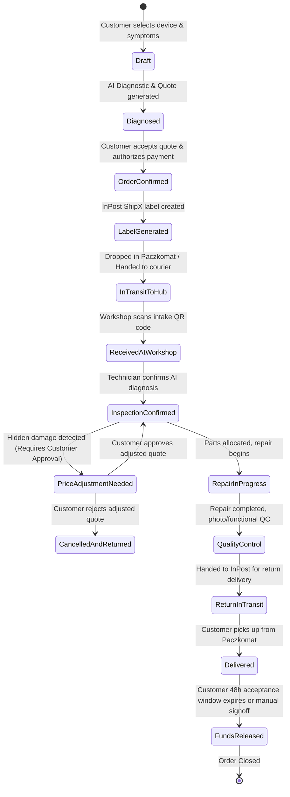

# Backend Technology Stack & Architecture Proposal

> **Status:** APPROVED & ADOPTED  
> **Target Frontend:** React Native (TypeScript) + Mobile & Web  
> **Target Project:** Repair God (`repair_god_indev`)  
> **Author:** Architecture Team  
> **Last Updated:** 2026-10-27

---

## 1. Executive Summary & Recommendation

To complement the client application built with **React Native + TypeScript**, the recommended backend architecture for the **Repair God** platform is:

```
┌──────────────────────────────────────────────────────────────────────────────────┐
│                             PRIMARY BACKEND STACK                                │
├──────────────────────────┬───────────────────────────────────────────────────────┤
│ Runtime & Language       │ Node.js 20+ LTS / TypeScript 5+                       │
│ Application Framework    │ NestJS (Fastify adapter for maximum throughput)       │
│ Primary Database         │ PostgreSQL 16+ with PostGIS & pgvector                │
│ ORM / Query Layer        │ Prisma ORM (or Drizzle ORM) for end-to-end type safety│
│ Cache & Task Queue       │ Redis 7+ with BullMQ (async job processing)           │
│ Real-Time Communication  │ WebSockets (Socket.io / ws) & Server-Sent Events (SSE) │
│ Object Storage           │ S3-compatible storage (MinIO / Cloud Storage / S3)    │
│ AI Diagnostic Engine     │ Google Gemini API (Multimodal Vision + Structured JSON)│
│ Logistics & Payments     │ InPost ShipX API, PayU / Przelewy24 / Stripe (Escrow) │
└──────────────────────────┴───────────────────────────────────────────────────────┘
```

This decision maximizes **developer velocity**, eliminates **type drift** between the React Native frontend and backend, strictly enforces **Domain-Driven Design (DDD)** and state machine integrity (FSM), and smoothly accommodates critical integrations (InPost Paczkomat APIs, BLIK/escrow payments, and multimodal AI triage).

---

## 2. Comparative Analysis of Backend Alternatives

We evaluated four main backend architectural paradigms against the core business and technical requirements of Repair God:

| Criteria | 1. NestJS (Node.js/TS) *(Recommended)* | 2. FastAPI (Python) | 3. Go (Golang) | 4. Supabase / BaaS Hybrid |
| :--- | :--- | :--- | :--- | :--- |
| **End-to-End Type Safety** | ⭐⭐⭐⭐⭐ Shared Zod/TS types with React Native | ⭐⭐⭐ Requires OpenAPI schema codegen | ⭐⭐ Requires codegen, boilerplate mappings | ⭐⭐⭐ Shared types via DB generator |
| **Domain-Driven Design (DDD)** | ⭐⭐⭐⭐⭐ Out-of-the-box DI, modules, clean layers | ⭐⭐⭐ Unopinionated, requires custom boilerplate | ⭐⭐⭐ Explicit, but verbose domain modeling | ⭐⭐ Hard to model complex domain rules |
| **Logistics & Escrow FSM** | ⭐⭐⭐⭐⭐ Robust state machine libs (XState, BullMQ) | ⭐⭐⭐⭐ Good with Celery / Temporal | ⭐⭐⭐⭐ Strong concurrency, but heavy code | ⭐⭐ Triggers/RLS get unwieldy for multi-party |
| **AI Integration** | ⭐⭐⭐⭐ Seamless LLM SDKs (Gemini, LangChain) | ⭐⭐⭐⭐⭐ Native ML ecosystem (PyTorch, OpenCV) | ⭐⭐ REST wrappers only | ⭐⭐⭐ Edge Functions / External webhooks |
| **Polish Market APIs** | ⭐⭐⭐⭐⭐ Native Node SDKs (InPost ShipX, PayU, P24) | ⭐⭐⭐ Community scripts, mostly raw HTTP | ⭐⭐ Limited SDKs, manual HTTP clients | ⭐⭐ InPost HMAC & webhook handling is awkward |
| **Hiring & Team Velocity** | ⭐⭐⭐⭐⭐ Universal TypeScript talent pool across stack | ⭐⭐⭐⭐ Large Python talent pool | ⭐⭐⭐ Higher engineering cost | ⭐⭐⭐⭐ Fast setup, slows down at scale |
| **Real-time Status Updates** | ⭐⭐⭐⭐⭐ Native NestJS WebSockets / SSE | ⭐⭐⭐⭐ Native WebSockets | ⭐⭐⭐⭐⭐ Native Goroutines / WS | ⭐⭐⭐⭐ Realtime engine built-in |

### Why NestJS + TypeScript Wins:
1. **Single Language Across the Monorepo:** Sharing DTOs, Zod validation schemas, and enum definitions (e.g., `OrderStatus`, `DeviceCategory`, `ShippingMethod`) between React Native and the backend cuts API integration errors to near zero.
2. **Enterprise Architecture for Complex Workflows:** NestJS provides dependency injection, interceptors, pipes, and modular boundaries out of the box, preventing the backend from devolving into spaghetti code as business domains expand (`logistics`, `billing`, `diagnostics`, `workshops`).
3. **Optimized for Polish Market Realities:** The Polish e-commerce landscape requires robust support for InPost ShipX (Paczkomaty 24/7), BLIK, and escrow payout schemes. Node.js has battle-tested libraries and straightforward cryptographic signature handling for InPost and payment gateways.

---

## 3. High-Level Architecture & Monorepo Structure

We recommend a **Turborepo** or **pnpm workspace** monorepo to organize the codebase cleanly:

```
repair_god/
├── apps/
│   ├── mobile/                    # React Native / Expo application
│   │   ├── src/
│   │   │   ├── features/          # Customer intake, device passport, tracking
│   │   │   └── navigation/
│   │   └── package.json
│   ├── api/                       # NestJS Core Backend
│   │   ├── src/
│   │   │   ├── modules/           # DDD Domain modules
│   │   │   │   ├── auth/          # JWT, Refresh Tokens, B2C/B2B RBAC
│   │   │   │   ├── customers/     # Customer profiles, device ownership
│   │   │   │   ├── devices/       # Device taxonomy, specifications, serial/IMEI
│   │   │   │   ├── diagnostics/   # AI triage engine & photo inspection
│   │   │   │   ├── orders/        # Order lifecycle FSM & coordinator
│   │   │   │   ├── workshops/     # Partner repair centers & technician assignment
│   │   │   │   ├── logistics/     # InPost ShipX, courier labels, tracking webhooks
│   │   │   │   └── billing/       # Escrow, BLIK, PayU/P24/Stripe, invoicing
│   │   │   ├── common/            # Filters, interceptors, guards, decorators
│   │   │   └── main.ts
│   │   └── package.json
│   └── workshop-web/              # Web Portal for Technicians (React / Vite)
├── packages/
│   ├── contracts/                 # Shared Zod schemas, DTOs & API interfaces
│   ├── ui-tokens/                 # Shared theme colors, design tokens
│   └── tsconfig/                  # Shared TypeScript configuration
├── docker-compose.yml             # Postgres, Redis, MinIO for local development
└── package.json
```

---

## 4. Key Subsystem Specifications

### 4.1. Order & Shipment Lifecycle as a Finite State Machine (FSM)
Repair orders undergo strict, auditable lifecycle transitions. The backend uses a deterministic state machine to guarantee that state cannot be bypassed (e.g. payout cannot be released before customer inspection signoff):



### 4.2. AI Diagnostic & Triage Pipeline
- **Intake Modality:**
  1. Structured questionnaire (device brand, model, issue categories: battery, display, liquid damage, charging port, board).
  2. Guided photo uploads (front, back, edges, screen on/off, macro damage).
- **Processing Engine:**
  - Fastify / NestJS receives the multipart upload and generates pre-signed S3 URLs.
  - NestJS triggers an async job via **BullMQ**.
  - Worker passes image URLs and symptom prompts to the **Google Gemini Multimodal API** (`gemini-1.5-flash` or `gemini-2.0-flash`).
  - Structured output enforced via JSON Schema response format:
    ```typescript
    interface AIDiagnosticOutput {
      suspectedFailure: string[];
      severity: 'LOW' | 'MEDIUM' | 'HIGH' | 'CRITICAL';
      batteryHazardWarning: boolean;
      estimatedPartsRequired: string[];
      repairFeasibilityScore: number; // 0.0 - 1.0
      estimatedPriceRangePLN: { min: number; max: number };
      estimatedTurnaroundDays: { min: number; max: number };
      technicianFocusNotes: string;
    }
    ```
- **Fallback & Confidence Guardrails:**
  - If AI confidence is below threshold (< 0.75), order routes to manual technician triage before courier dispatch.
  - High-risk cases (bloated battery, scorch marks) trigger automatic safety handling alerts.

### 4.3. Logistics Module (InPost ShipX Focus)
Because 82% of Polish door-to-door repair transit relies on InPost Paczkomaty:
- **InPost ShipX Integration:**
  - Automated generation of locker-to-hub and locker-to-workshop shipments.
  - Generation of standard shipping labels (PDF/ZPL) stored in S3.
  - Geolocation-based Paczkomat picker API integration for React Native frontend.
  - Webhook ingestion endpoint (`POST /api/v1/logistics/webhooks/inpost`) with HMAC signature verification to update shipment tracking states in real-time.

### 4.4. Billing & Escrow Safe Settlement
- **Customer Protection:** Payment is authorized upfront (BLIK / Apple Pay / Google Pay / Credit Card via PayU, Przelewy24, or Stripe).
- **Escrow Hold:** Funds remain held in escrow during transit, inspection, and repair.
- **Scope & Price Adjustments:** If the workshop uncovers internal damage (e.g., corroded motherboard), the order is paused. The customer receives a push notification in the React Native app with comparison photos and the revised quote. Additional funds are only held if approved.
- **Split Payout:** Upon customer receipt and QC signoff, the platform automatically captures payment, distributes workshop earnings minus platform commission, and generates automated VAT invoices (B2B and B2C).

---

## 5. Security, Compliance & Data Governance

1. **Customer Data Privacy:**
   - Strict intake protocol: Customers are guided to back up and factory reset devices when possible, or activate Apple "Repair State" / Android "Maintenance Mode".
   - Photos uploaded for inspection are stored in private S3 buckets with time-limited pre-signed URLs (15-minute TTL).
2. **Role-Based Access Control (RBAC):**
   - Four distinct privilege levels: `CUSTOMER`, `TECHNICIAN`, `WORKSHOP_OWNER`, `ENTERPRISE_MANAGER`, `PLATFORM_ADMIN`.
   - Technicians only view customer details required for repair and return shipping, preventing unauthorized data access.
3. **Audit Trail (Chain of Custody):**
   - Every physical handover (Customer -> Paczkomat -> Courier -> Workshop -> Return) requires digital verification: QR code scan, timestamp, and automated photographic condition logging.

---

## 6. Implementation Milestones

| Phase | Duration | Key Backend Deliverables |
| :--- | :--- | :--- |
| **Phase 1: Foundations & Auth** | Weeks 1–2 | Monorepo setup, NestJS scaffolding, PostgreSQL schema, JWT/RBAC auth, device catalog endpoints. |
| **Phase 2: Order FSM & AI Diagnostics** | Weeks 3–4 | Order state machine, S3 image upload with pre-signed URLs, Gemini multimodal triage worker with BullMQ. |
| **Phase 3: Logistics & InPost Integration** | Weeks 5–6 | InPost ShipX API integration, shipment creation, tracking webhook consumer, push notification triggers. |
| **Phase 4: Billing & Escrow** | Weeks 7–8 | Payment gateway integration (BLIK, card), escrow authorization/capture flow, payout calculation, automated invoicing. |
| **Phase 5: Real-time & B2B Fleet Hub** | Weeks 9–10 | WebSocket live tracking, technician workspace endpoints, corporate fleet bulk intake API. |
