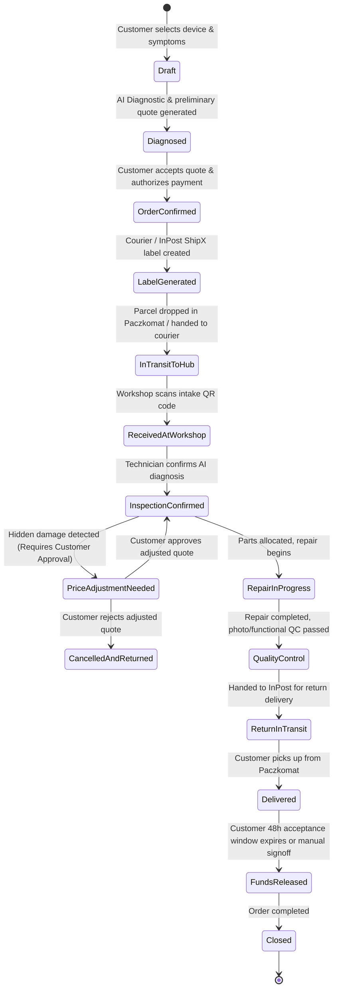

# Repair God — Order & Shipment Finite State Machine (FSM)

> **Source of Truth for packages/fsm and Order Transitions**  
> **Rule:** Any change to order/shipment status must strictly transit via `packages/fsm`. No direct database status mutations.

---

## 1. Core Principles

1. **Deterministic & Auditable:** All state transitions are explicit, idempotent, and emit an `OrderStatusEvent` with timestamp and actor (`CUSTOMER`, `TECHNICIAN`, `SYSTEM`, etc.).
2. **Escrow Invariance:** Funds cannot be captured or released until QC and Customer confirmation/acceptance window expiration.
3. **Customer Approval Invariance:** Any price or scope change detected during inspection transitions the order to `PriceAdjustmentNeeded` and halts work until explicit customer approval.

---

## 2. Order Lifecycle States

---

## 3. State Definitions & Allowed Transitions

| State | Trigger / Condition | Next Allowed States | Actor |
| :--- | :--- | :--- | :--- |
| `Draft` | User starts triage wizard | `Diagnosed`, `Cancelled` | Customer |
| `Diagnosed` | AI triage completes | `OrderConfirmed`, `Draft`, `Cancelled` | System |
| `OrderConfirmed` | Payment authorized, escrow hold placed | `LabelGenerated`, `Cancelled` | Customer / System |
| `LabelGenerated` | InPost ShipX shipment created | `InTransitToHub`, `Cancelled` | System |
| `InTransitToHub` | Courier scans parcel / Paczkomat intake | `ReceivedAtWorkshop` | Courier / Webhook |
| `ReceivedAtWorkshop`| Workshop technician scans QR intake | `InspectionConfirmed`, `PriceAdjustmentNeeded` | Technician |
| `PriceAdjustmentNeeded`| Additional fault discovered | `InspectionConfirmed`, `CancelledAndReturned` | Technician |
| `InspectionConfirmed`| Customer approves quote / no change | `RepairInProgress`, `CancelledAndReturned` | Customer / Tech |
| `RepairInProgress` | Technician works on hardware | `QualityControl` | Technician |
| `QualityControl` | Hardware passed all tests & photo logged | `ReturnInTransit` | Technician |
| `ReturnInTransit` | Return label scanned by courier | `Delivered` | Courier / Webhook |
| `Delivered` | Customer receives device | `FundsReleased`, `Disputed` | Courier / Customer |
| `FundsReleased` | 48h window passed or customer signoff | `Closed` | System |
| `Disputed` | Customer reports defect within 48h | `UnderInvestigation` | Customer |
| `Closed` | Escrow settled, invoice generated | `[*]` | System |
